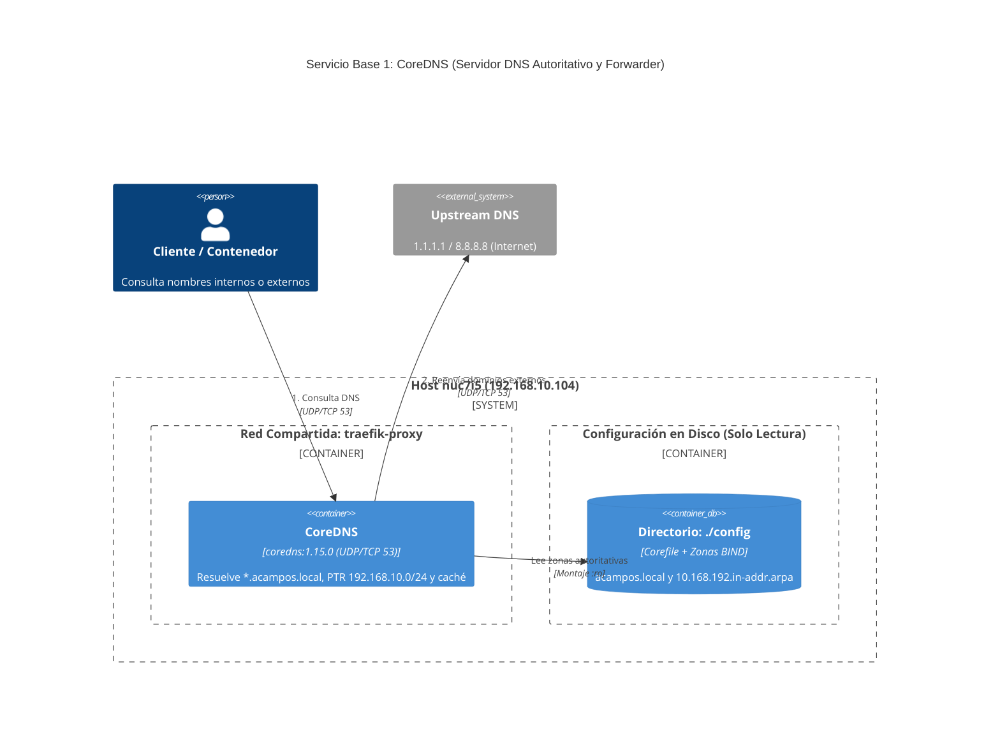

## 1. High Level Architecture

CoreDNS es un servicio _stateless_ (sin base de datos) que carga sus reglas y zonas autoritativas directamente desde ficheros de texto planos montados en modo solo lectura (`:ro`) desde `/opt/core-dns/config`.



## 2. Requerimientos

- [[00-coredns-host-prepare|Preparación del host]]
- [[install-dig|Instalación de Dig]]

## 3. Configuraciones


Crea la estructura de directorios en `/opt/core-dns`:

```bash
sudo mkdir -p /opt/core-dns/config/zones
```

Establece el propietario de la carpeta

```bash
sudo chown -R $USER:$USER /opt/core-dns
```

### 3.1. Archivo principal (`Corefile`)

El archivo `/opt/core-dns/config/Corefile` define qué zonas gestiona CoreDNS directamente y a qué servidores externos reenvía las peticiones de Internet.

```ini
# Zona directa autoritativa para el dominio interno
acampos.local:53 {
    file /etc/coredns/zones/acampos.local
    log
    errors
}

# Zona inversa para resolución de IPs a nombres (PTR) en la subred 192.168.10.0/24
10.168.192.in-addr.arpa:53 {
    file /etc/coredns/zones/10.168.192.in-addr.arpa
    log
    errors
}

# Reenvío (Forwarding) para cualquier otro dominio externo (Internet)
.:53 {
    forward . 1.1.1.1 8.8.8.8
    cache 30
    log
    errors
}
```

### 3.2. Archivo de Zona Directa (`acampos.local`)

Incluimos un registro **Wildcard (`*`)** apuntando a `192.168.10.104`. De este modo, **cualquier servicio futuro** (`portainer`, `jenkins`, `gitlab`, `nexus`, `quay`, etc.) resolverá automáticamente hacia Traefik sin tener que editar esta zona cada vez.

```c
$ORIGIN acampos.local.
$TTL 3600

@   IN  SOA ns1.acampos.local. admin.acampos.local. (
        2026111601 ; Serial (YYYYMMDDNN - incrementar en cada cambio)
        7200       ; Refresh
        3600       ; Retry
        1209600    ; Expire
        3600       ; Minimum TTL
)

; Servidor de nombres
@           IN  NS  ns1.acampos.local.
ns1         IN  A   192.168.10.104

; Registros base del host y servicios principales
nuc         IN  A   192.168.10.104
ca          IN  A   192.168.10.104
traefik     IN  A   192.168.10.104

; Wildcard: redirige todos los subdominios *.acampos.local hacia Traefik
*           IN  A   192.168.10.104
```

### 3.3. Archivo de Zona Inversa (`10.168.192.in-addr.arpa`)

Permite que herramientas de diagnóstico (`nslookup 192.168.10.104`, `dig -x`) identifiquen correctamente el servidor.

```d
$ORIGIN 10.168.192.in-addr.arpa.
$TTL 3600

@   IN  SOA ns1.acampos.local. admin.acampos.local. (
        2026111601 ; Serial
        7200       ; Refresh
        3600       ; Retry
        1209600    ; Expire
        3600       ; Minimum TTL
)

@   IN  NS  ns1.acampos.local.

; Registros PTR (último octeto de la IP -> FQDN)
104 IN  PTR nuc.acampos.local.
```

### 3.4. Archivo Compose (`compose.yml`)

```yaml
services:
  coredns:
    image: coredns/coredns:1.15.0
    container_name: coredns
    restart: unless-stopped
    command: -conf /etc/coredns/Corefile
    networks:
      - traefik-proxy
    ports:
      - "53:53/udp"
      - "53:53/tcp"
    volumes:
      - ./config:/etc/coredns:ro

networks:
  traefik-proxy:
    external: true
```

## 4. Despliegue

```bash
cd /opt/core-dns
```

```bash
docker compose up -d
```

### 4.1 Verificaciones

**Verificación:** Comprueba tanto la resolución directa como la inversa y la salida a Internet

#### Resolución directa

```bash
dig @192.168.10.104 traefik.acampos.local +short
```

> [!note]
> Si lo ejecutamos desde el mismo host donde ejecutamos el contenedor de CoreDNS, debemos utilizar el comando:
> ```bash
> dig @localhost traefik.acampos.local +short
> ```

Debe devolver:

```output
192.168.10.104
```

```bash
dig @192.168.10.104 portainer.acampos.local +short
```

Debe devolver:

```output
192.168.10.104
```

#### Resolución inversa

```bash
dig @192.168.10.104 -x 192.168.10.104 +short
```

Debe devolver:

```output
nuc.acampos.local.
```

#### Resolución de nombres por DNS forward

```bash
dig @192.168.10.104 google.com +short
```

Debe devolver la  IP pública. Por ejemplo:

```output
192.178.25.110
```
