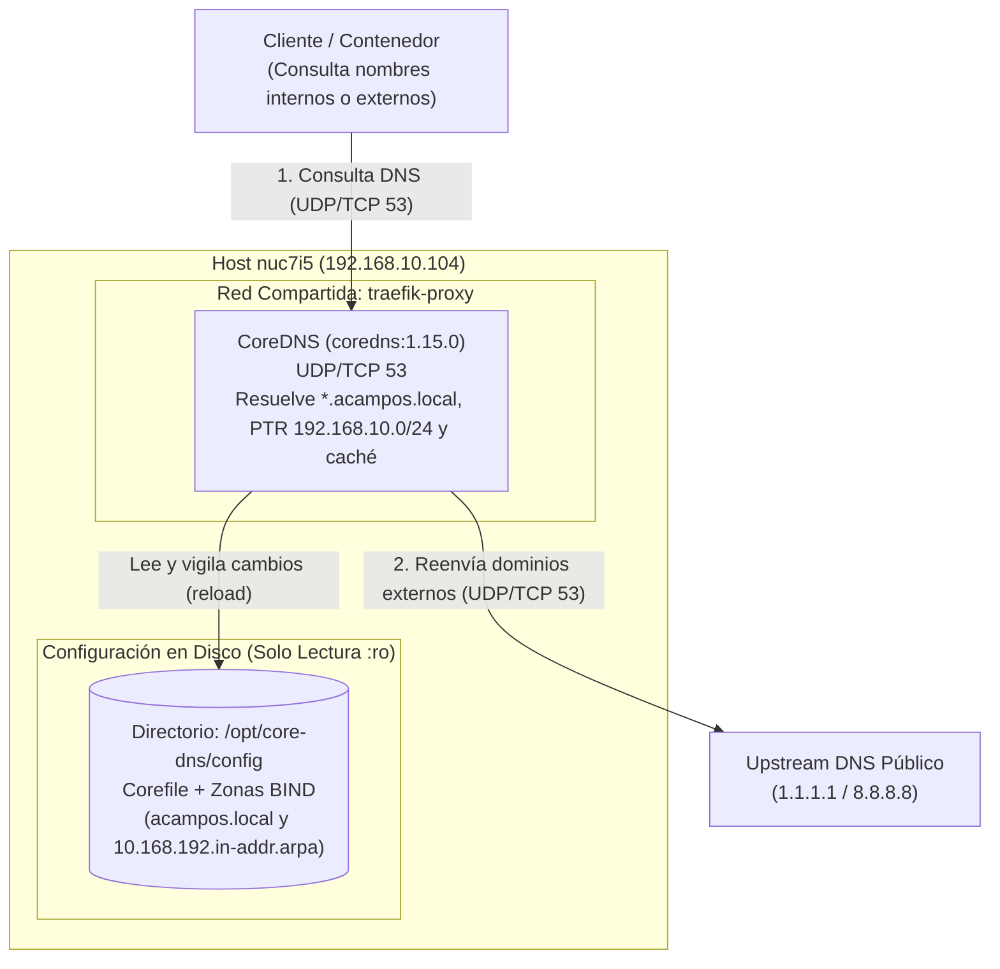

## 1. High Level Architecture

**CoreDNS** es un servidor DNS modular y _stateless_ (sin base de datos) escrito en Go y graduado por la [CNCF](https://www.cncf.io/projects/coredns/). En nuestro laboratorio actúa como el **Servicio Base 00**, cargando sus reglas y zonas autoritativas directamente desde ficheros de texto en formato estándar BIND (RFC 1035) montados en modo solo lectura (`:ro`) desde `/opt/core-dns/config`.

> [!important] ¿Por qué CoreDNS es el primer servicio en desplegarse?
> Tanto [[02-step-ca|Smallstep step-ca]] como [[03-traefik|Traefik v3]] dependen de que la resolución de `*.acampos.local` esté operativa antes de arrancar: cuando Traefik solicita un certificado TLS mediante el protocolo ACME, `step-ca` consulta a CoreDNS para resolver el dominio del servicio hacia `192.168.10.104` y validar el desafío `HTTP-01` en el puerto `80`.



---

## 2. Requerimientos previos

Antes de configurar y desplegar CoreDNS, asegúrate de haber completado los siguientes pasos en el servidor anfitrión (`192.168.10.104`):

- [[00-coredns-host-prepare|Preparación del host]]: Liberación del puerto `53` desactivando el `DNSStubListener` de `systemd-resolved` y creación de la red Docker externa `traefik-proxy`.
- [[install-dig|Instalación de Dig]]: Utilidad `dig` (paquete `dnsutils`) instalada para verificar registros `A`, comodines (`wildcard`) y resolución inversa (`PTR`).

Verifica que la red `traefik-proxy` existe (si no la creaste durante la preparación del host, créala ahora):

```bash
docker network inspect traefik-proxy >/dev/null 2>&1 || docker network create traefik-proxy
```

## 3. Configuraciones

Crea la estructura de directorios en `/opt/core-dns`:

```bash
sudo mkdir -p /opt/core-dns/config/zones
```

Asigna la propiedad a tu usuario:

```bash
sudo chown -R $USER:$USER /opt/core-dns
```

La estructura final del servicio en disco será la siguiente:

```text
/opt/core-dns/
├─ compose.yml
└─ config/
   ├─ Corefile
   └─ zones/
      ├─ acampos.local
      └─ 10.168.192.in-addr.arpa
```

### 3.1. Archivo principal (`/opt/core-dns/config/Corefile`)

El archivo `Corefile` define qué zonas gestiona CoreDNS directamente como servidor autoritativo, cómo recarga los ficheros en caliente (`reload`) y a qué servidores externos reenvía las peticiones hacia Internet:

```ini
# Zona directa autoritativa para el dominio interno del laboratorio
acampos.local:53 {
    file /etc/coredns/zones/acampos.local
    reload 10s
    log
    errors
}

# Zona inversa para resolución de IPs a nombres (PTR) en la subred 192.168.10.0/24
10.168.192.in-addr.arpa:53 {
    file /etc/coredns/zones/10.168.192.in-addr.arpa
    reload 10s
    log
    errors
}

# Reenvío (Forwarding) para cualquier otro dominio externo (Internet)
.:53 {
    forward . 1.1.1.1 8.8.8.8
    cache 30
    reload 10s
    log
    errors
}
```

#### Desglose de plugins utilizados en el `Corefile`

| Plugin | Función técnica |
| :--- | :--- |
| **`file`** | Sirve datos de zona autoritativa leyendo un fichero con sintaxis estándar BIND ([RFC1035](https://www.rfc-editor.org/info/rfc1035). |
| **`reload 10s`** | Comprueba cada 10 segundos si el número de serie (`Serial`) del registro `SOA` ha aumentado en los ficheros de zona y recarga los cambios en memoria sin reiniciar el contenedor. |
| **`forward`** | Reenvía cualquier consulta que no pertenezca a `acampos.local` ni a la zona inversa hacia los resolvedores públicos de Cloudflare (`1.1.1.1`) y Google (`8.8.8.8`). |
| **`cache 30`** | Almacena en caché las respuestas externas durante un máximo de 30 segundos para reducir la latencia de red. |
| **`log` / `errors`** | Registra por salida estándar (`stdout` / `docker logs`) las consultas recibidas y cualquier error sintáctico o de resolución. |

### 3.2. Archivo de Zona Directa (`/opt/core-dns/config/zones/acampos.local`)

En el archivo de zona directa incluimos tanto los registros explícitos de la infraestructura base como un registro **Wildcard (`*`)** apuntando a `192.168.10.104`. De este modo, **cualquier servicio publicado en el laboratorio** ([[04-portainer|Portainer]], [[05-jenkins|Jenkins]], [[06-gitlab|GitLab]], [[07-nexus|Nexus]], [[08-quay|Quay]], etc.) resolverá automáticamente hacia [[03-traefik|Traefik]] sin necesidad de editar la zona DNS cada vez que añadamos un contenedor nuevo.

```dns
$ORIGIN acampos.local.
$TTL 3600

@   IN  SOA ns1.acampos.local. admin.acampos.local. (
        2026111801 ; Serial (Formato YYYYMMDDNN - ¡incrementar en cada cambio!)
        7200       ; Refresh (2 horas)
        3600       ; Retry (1 hora)
        1209600    ; Expire (14 días)
        3600       ; Minimum TTL (1 hora)
)

; Servidor de nombres autoritativo de la zona
@           IN  NS  ns1.acampos.local.
ns1         IN  A   192.168.10.104

; Registros explícitos del host y servicios de infraestructura
nuc         IN  A   192.168.10.104
ca          IN  A   192.168.10.104
traefik     IN  A   192.168.10.104

; Wildcard: redirige todos los subdominios *.acampos.local hacia Traefik
*           IN  A   192.168.10.104
```

> [!warning] Reglas críticas de sintaxis BIND (RFC 1035)
> 1. **Puntos finales en nombres cualificados (`FQDN`):** En los ficheros de zona, todo dominio completo como `ns1.acampos.local.` debe terminar con un punto (`.`). Si omites el punto final, BIND/CoreDNS concatenará `$ORIGIN` al final produciendo `ns1.acampos.local.acampos.local.`.
> 2. **Correo del administrador en el registro `SOA`:** En `admin.acampos.local.`, el primer punto equivale al símbolo `@` (`admin@acampos.local`).
> 3. **Incremento del `Serial`:** El plugin `reload` de CoreDNS **ignora** los cambios en el archivo de zona a menos que incrementes el número `Serial` del bloque `SOA` (por ejemplo, de `2026111801` a `2026111802`).

### 3.3. Archivo de Zona Inversa (`/opt/core-dns/config/zones/10.168.192.in-addr.arpa`)

La zona inversa traduce direcciones IP de la subred `192.168.10.0/24` (escrita al revés como `10.168.192.in-addr.arpa`) a nombres de dominio mediante registros **`PTR`**. Esto evita retardos por _timeout_ en conexiones SSH y permite que herramientas de diagnóstico (`dig -x 192.168.10.104`, `nslookup`) identifiquen inmediatamente al servidor anfitrión.

```dns
$ORIGIN 10.168.192.in-addr.arpa.
$TTL 3600

@   IN  SOA ns1.acampos.local. admin.acampos.local. (
        2026111801 ; Serial (Incrementar al modificar registros PTR)
        7200       ; Refresh
        3600       ; Retry
        1209600    ; Expire
        3600       ; Minimum TTL
)

@   IN  NS  ns1.acampos.local.

; Registros PTR (último octeto de la IP 192.168.10.X -> FQDN terminado en punto)
104 IN  PTR nuc.acampos.local.
```

### 3.4. Archivo Compose (`/opt/core-dns/compose.yml`)

Crea el archivo `/opt/core-dns/compose.yml`. Aunque el contenedor de CoreDNS se ejecuta como binario estático mínimo, declaramos explícitamente la capacidad [[CAP_NET_BIND_SERVICE]] y la opción de seguridad `no-new-privileges:true` siguiendo el principio de mínimo privilegio para escuchar en el puerto privilegiado `53` (`< 1024`):

```yaml
services:
  coredns:
    image: coredns/coredns:1.15.0
    container_name: coredns
    restart: unless-stopped
    command: -conf /etc/coredns/Corefile
    cap_add:
      - NET_BIND_SERVICE
    security_opt:
      - no-new-privileges:true
    networks:
      - traefik-proxy
    ports:
      - "53:53/udp"
      - "53:53/tcp"
    volumes:
      - ./config:/etc/coredns:ro

networks:
  traefik-proxy:
    external: true
```

## 4. Despliegue y Verificación

Sitúate en el directorio `/opt/core-dns` y levanta el contenedor en segundo plano:

```bash
cd /opt/core-dns
```

```bash
docker compose up -d
```

Comprueba que el contenedor ha arrancado sin errores de sintaxis en los ficheros de zona:

```bash
docker logs coredns
```

### 4.1. Verificaciones de resolución DNS

Utiliza `dig` apuntando a la IP del host (`@192.168.10.104`) para validar los tres modos de operación: resolución directa explícita y por comodín (`wildcard`), resolución inversa (`PTR`) y reenvío externo (`forward`).

#### 1. Resolución directa (Explícita y Wildcard)

```bash
dig @192.168.10.104 traefik.acampos.local +short
```

> [!note]
> Si ejecutas la prueba desde el propio servidor anfitrión donde corre el contenedor de CoreDNS, puedes consultar tanto a `@192.168.10.104` como a `@localhost`:
> ```bash
> dig @localhost traefik.acampos.local +short
> ```

Debe devolver:

```output
192.168.10.104
```

Ahora verifica que el registro comodín (`*.acampos.local`) resuelve cualquier subdominio de servicios futuros (por ejemplo, `portainer.acampos.local` o `gitlab.acampos.local`):

```bash
dig @192.168.10.104 portainer.acampos.local +short
```

Debe devolver:

```output
192.168.10.104
```

#### 2. Resolución inversa (`PTR`)

```bash
dig @192.168.10.104 -x 192.168.10.104 +short
```

Debe devolver:

```output
nuc.acampos.local.
```

#### 3. Resolución de dominios externos por DNS Forwarding

```bash
dig @192.168.10.104 google.com +short
```

Debe devolver una dirección IP pública válida, por ejemplo:

```output
192.178.25.110
```

## 5. Configuración de Clientes DNS y Operación

Una vez verificado que CoreDNS responde en `192.168.10.104:53`, configura el propio host y los equipos de tu red local para que lo utilicen como servidor DNS principal:

1. **En el propio servidor anfitrión (`/etc/systemd/resolved.conf`):**
   Sustituye el DNS temporal por la IP local `127.0.0.1` (con `1.1.1.1` como `FallbackDNS`) y reinicia `systemd-resolved`:

```toml
[Resolve]
DNS=127.0.0.1
FallbackDNS=1.1.1.1 8.8.8.8
Domains=~acampos.local
DNSStubListener=no
```

2. **En contenedores críticos como `step-ca`:**
   En el `compose.yml` de [[00-step-ca|Smallstep step-ca]], añade siempre la directiva `dns: [192.168.10.104]` para garantizar que el contenedor utilice CoreDNS al validar los certificados ACME internos.

3. **En el router / servidor DHCP de la LAN (o en tu estación de trabajo):**
   Configura `192.168.10.104` como servidor DNS primario para que cualquier navegador en la red local pueda abrir `https://traefik.acampos.local` o `https://portainer.acampos.local` directamente.
