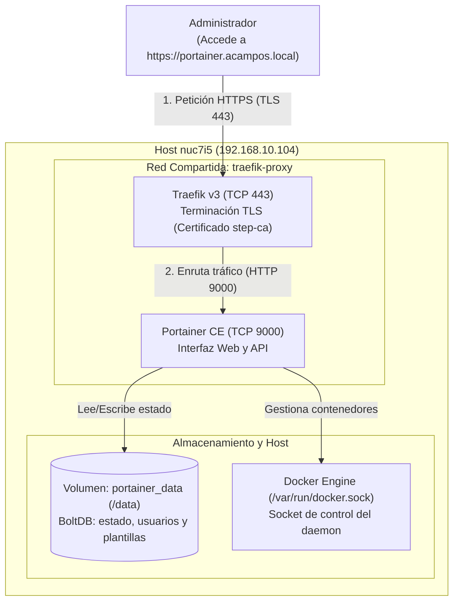

## 1. High Level Architecture

**Portainer CE** proporciona una interfaz web y una API para administrar contenedores, pilas (`stacks` de Docker Compose), redes y volúmenes. No requiere una base de datos externa: almacena su configuración, usuarios y plantillas en una base de datos embebida (**BoltDB**) dentro del volumen persistente `portainer_data` y se comunica con el motor de contenedores montando `/var/run/docker.sock`.

El servicio no expone puertos directamente en el host; todo el tráfico entra por [[01-traefik|Traefik v3]] en `https://portainer.acampos.local` (`TCP 443`) y se enruta internamente hacia `portainer:9000` por la red `traefik-proxy`.



---

## 2. Requerimientos previos

- [[00-coredns|00. CoreDNS]] resolviendo `portainer.acampos.local` -> `192.168.10.104`.
- [[00-step-ca|00. Smallstep step-ca]] y [[01-traefik|01. Traefik v3]] en ejecución.

---

## 3. Configuraciones

Crea el directorio `/opt/portainer` y asigna los permisos a tu usuario:

```bash
sudo mkdir -p /opt/portainer
```

```bash
sudo chown -R $USER:$USER /opt/portainer
```

### 3.1. Archivo Compose (`/opt/portainer/compose.yml`)

```yaml
services:
  portainer:
    image: portainer/portainer-ce:lts
    container_name: portainer
    labels:
      - traefik.enable=true
      - traefik.docker.network=traefik-proxy
      - traefik.http.routers.portainer.rule=Host(`portainer.acampos.local`)
      - traefik.http.routers.portainer.entrypoints=websecure
      - traefik.http.routers.portainer.tls=true
      - traefik.http.routers.portainer.tls.certresolver=stepca
      - traefik.http.services.portainer.loadbalancer.server.port=9000
    networks:
      - portainer-internal
      - traefik-proxy
    restart: unless-stopped
    security_opt:
      - no-new-privileges:true
    volumes:
      - /var/run/docker.sock:/var/run/docker.sock
      - portainer_data:/data

networks:
  portainer-internal:
  traefik-proxy:
    external: true

volumes:
  portainer_data:
```

## 4. Despliegue y Verificación

1. Levanta el contenedor de Portainer:

```bash
cd /opt/portainer
```

```bash
docker compose up -d
```

2. Verifica la emisión del certificado TLS y la respuesta HTTP del servicio:

```bash
curl -I --cacert /opt/traefik/root_ca.crt https://portainer.acampos.local
```

> [!warning] Ventana de seguridad de 5 minutos en el primer arranque
> Accede a `https://portainer.acampos.local` durante los **primeros 5 minutos** tras el despliegue para crear el usuario administrador inicial. Si transcurre ese tiempo sin configurar la cuenta, Portainer bloqueará el asistente inicial por seguridad y deberás reiniciar el contenedor (`docker restart portainer`) para reactivarlo.