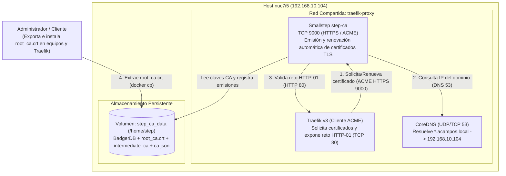

## 1. High Level Architecture

**Smallstep `step-ca`** actúa como nuestra **Autoridad Certificadora (PKI) privada** y servidor **ACME** interno (equivalente a un _Let's Encrypt_ local). Almacena su configuración, claves privadas de la CA raíz e intermedia y el registro de certificados emitidos en una base de datos **BadgerDB** embebida dentro del volumen persistente `step_ca_data`.

Cuando [[01-traefik|Traefik v3]] detecta un nuevo contenedor publicado bajo `*.acampos.local`, solicita automáticamente un certificado TLS a `step-ca` mediante el protocolo ACME (`HTTP-01`). Para validar ese desafío, `step-ca` consulta a [[00-coredns|CoreDNS]] (`192.168.10.104:53`) para resolver el nombre de dominio hacia Traefik y verificar el token en el puerto `80`.



## 2. Requerimientos previos

- [[00-coredns|00. CoreDNS]] desplegado y resolviendo `*.acampos.local` hacia `192.168.10.104`.
- Red externa `traefik-proxy` creada en Docker.

## 3. Configuraciones

Crea los directorios de trabajo para `step-ca` y `traefik` en `/opt` y asigna la propiedad a tu usuario:

```bash
sudo mkdir -p /opt/step-ca /opt/traefik
```

```bash
sudo chown -R $USER:$USER /opt/step-ca /opt/traefik
```

### 3.1. Variables de inicialización (`/opt/step-ca/.env`)

En su primer arranque, la imagen oficial `smallstep/step-ca` inicializa automáticamente la PKI y habilita el provisionador **ACME** si se le proporcionan las siguientes variables de entorno en `/opt/step-ca/.env`:

```ini
DOCKER_STEPCA_INIT_NAME=Acampos Private CA
DOCKER_STEPCA_INIT_DNS_NAMES=ca.acampos.local,step-ca,localhost,127.0.0.1,192.168.10.104
DOCKER_STEPCA_INIT_PASSWORD=CambiaEstaPasswordSegura123!
DOCKER_STEPCA_INIT_ACME=true
```

> [!important] Nombres SAN del servidor ACME (`DOCKER_STEPCA_INIT_DNS_NAMES`)
> Es fundamental incluir tanto `ca.acampos.local` como el nombre de contenedor `step-ca` en `DOCKER_STEPCA_INIT_DNS_NAMES`. Traefik se conectará internamente a `https://step-ca:9000/acme/acme/directory` a través de la red `traefik-proxy`, por lo que el certificado TLS propio de `step-ca` debe ser válido para el hostname `step-ca`.

### 3.2. Archivo Compose (`/opt/step-ca/compose.yml`)

> [!warning] Directiva `dns` obligatoria
> Es imprescindible incluir la directiva `dns: [192.168.10.104]` en el `compose.yml` de `step-ca` para forzar al contenedor a utilizar nuestro [[00-coredns|CoreDNS]] al validar los desafíos `HTTP-01` de `*.acampos.local`. Sin ella, `step-ca` no sabrá a qué IP conectarse para verificar los dominios internos.

```yaml
services:
  step-ca:
    image: smallstep/step-ca:latest
    container_name: step-ca
    dns:
      - 192.168.10.104
    env_file:
      - .env
    healthcheck:
      test: ["CMD", "step", "ca", "health"]
      interval: 15s
      timeout: 5s
      retries: 3
      start_period: 10s
    networks:
      - traefik-proxy
    ports:
      - "9000:9000"
    restart: unless-stopped
    security_opt:
      - no-new-privileges:true
    volumes:
      - step_ca_data:/home/step

volumes:
  step_ca_data:

networks:
  traefik-proxy:
    external: true
```

## 4. Despliegue y Extracción del Certificado Raíz (`root_ca.crt`)

1. Levanta el contenedor de `step-ca`:

```bash
cd /opt/step-ca
```

```bash
docker compose up -d
```

2. Verifica que el daemon de la Autoridad Certificadora se ha inicializado y responde correctamente:

```bash
docker exec step-ca step ca health
```

Debe devolver:

```output
ok
```

3. **Extrae el certificado raíz público (`root_ca.crt`)** hacia el directorio de [[01-traefik|Traefik]] para que el cliente ACME de Traefik confíe en nuestra CA privada:

```bash
docker cp step-ca:/home/step/certs/root_ca.crt /opt/traefik/root_ca.crt
```

4. Verifica la validez y fecha de expiración del certificado raíz extraído:

```bash
openssl x509 -in /opt/traefik/root_ca.crt -noout -subject -issuer -dates
```

## 5. Instalación del Certificado Raíz en Clientes

Para que tu navegador web y herramientas CLI (`curl`, `git`, `docker`) confíen en todos los certificados `https://*.acampos.local` sin mostrar advertencias de seguridad, instala `root_ca.crt` en el almacén de confianza de tus equipos:

### En Linux (Ubuntu / Debian — incluido el propio host `nuc7i5`)

```bash
sudo cp /opt/traefik/root_ca.crt /usr/local/share/ca-certificates/acampos-root-ca.crt
```

```bash
sudo update-ca-certificates
```

### En Windows (PowerShell como Administrador)

```powershell
Import-Certificate -FilePath .\root_ca.crt -CertStoreLocation Cert:\LocalMachine\Root
```

> [!tip] Navegadores con almacén propio (Firefox)
> Si utilizas Mozilla Firefox, asegúrate de activar `security.enterprise_roots.enabled = true` en `about:config` o importa manualmente `root_ca.crt` en *Ajustes -> Privacidad y Seguridad -> Certificados -> Ver certificados -> Autoridades -> Importar*.