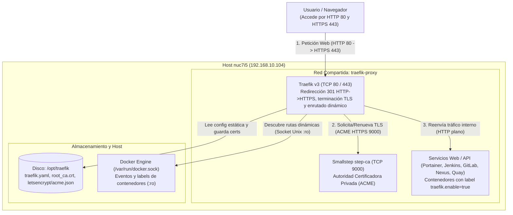

## 1. High Level Architecture

**Traefik v3** actúa como nuestro _Edge Router_ y _Reverse Proxy_ centralizado, siendo el único punto de entrada HTTP/HTTPS expuesto en los puertos `80` y `443` del host `192.168.10.104`.

Al igual que [[00-coredns|CoreDNS]], Traefik no utiliza base de datos externa: descubre los servicios dinámicamente escuchando los eventos del **socket de Docker** (`/var/run/docker.sock` montado en solo lectura) y persiste los certificados TLS emitidos por [[00-step-ca|Smallstep step-ca]] en un fichero JSON local (`/opt/traefik/letsencrypt/acme.json`) con permisos estrictos (`600`).



## 2. Requerimientos previos

- [[00-coredns|00. CoreDNS]] operativo y resolviendo `*.acampos.local` hacia `192.168.10.104`.
- [[00-step-ca|00. Smallstep step-ca]] operativo y con su certificado raíz extraído en `/opt/traefik/root_ca.crt`.

## 3. Configuraciones

### 3.1. Inicialización del almacenamiento ACME (`acme.json`)

Crea el directorio `/opt/traefik/letsencrypt` e inicializa el fichero `acme.json` con un objeto JSON válido (`{}`) y permisos `600`:

```bash
sudo mkdir -p /opt/traefik/letsencrypt
```

```bash
sudo chown -R $USER:$USER /opt/traefik
```

```bash
cd /opt/traefik
```

```bash
echo "{}" > ./letsencrypt/acme.json
```

```bash
chmod 600 ./letsencrypt/acme.json
```

> [!important] Permisos y contenido inicial de `acme.json`
> El archivo `acme.json` debe tener permisos `600` (solo lectura/escritura para el propietario) y contener al menos un objeto JSON vacío válido (`{}`). Si tiene permisos más abiertos (como `644`) o un tamaño de `0` bytes, Traefik deshabilitará el _resolver_ ACME por seguridad al arrancar.

### 3.2. Configuración estática (`/opt/traefik/traefik.yaml`)

El fichero `/opt/traefik/traefik.yaml` define los puntos de entrada (`web` en `:80` con redirección permanente `301` hacia `websecure` en `:443`), el proveedor de Docker (`exposedByDefault: false` para publicar solo los contenedores que tengan explícitamente `traefik.enable=true`) y el _resolver_ ACME apuntando a `step-ca`:

```yaml
global:
  checkNewVersion: false
  sendAnonymousUsage: false

log:
  level: INFO

accessLog: {}

api:
  dashboard: true
  insecure: false

entryPoints:
  web:
    address: ":80"
    http:
      redirections:
        entryPoint:
          to: websecure
          scheme: https
          permanent: true

  websecure:
    address: ":443"
    http:
      tls:
        certResolver: stepca

providers:
  docker:
    endpoint: "unix:///var/run/docker.sock"
    exposedByDefault: false
    network: traefik-proxy

certificatesResolvers:
  stepca:
    acme:
      email: admin@acampos.local
      storage: /letsencrypt/acme.json
      caServer: "https://step-ca:9000/acme/acme/directory"
      httpChallenge:
        entryPoint: web
```

### 3.3. Archivo Compose (`/opt/traefik/compose.yml`)

La librería ACME interna de Traefik (`lego`) necesita confiar en el certificado TLS del propio servidor `step-ca`. Para ello montamos `/opt/traefik/root_ca.crt` dentro del contenedor y lo referenciamos mediante la variable de entorno `LEGO_CA_CERTIFICATES`:

```yaml
services:
  traefik:
    image: traefik:v3
    container_name: traefik
    environment:
      # Permite al cliente ACME (lego) de Traefik confiar en el certificado raíz de step-ca
      - LEGO_CA_CERTIFICATES=/etc/ssl/certs/step_root_ca.crt
    labels:
      - traefik.enable=true
      - traefik.http.routers.traefik-dashboard.rule=Host(`traefik.acampos.local`)
      - traefik.http.routers.traefik-dashboard.entrypoints=websecure
      - traefik.http.routers.traefik-dashboard.tls=true
      - traefik.http.routers.traefik-dashboard.tls.certresolver=stepca
      - traefik.http.routers.traefik-dashboard.service=api@internal
    networks:
      - traefik-proxy
    ports:
      - "80:80"
      - "443:443"
    restart: unless-stopped
    security_opt:
      - no-new-privileges:true
    volumes:
      - /var/run/docker.sock:/var/run/docker.sock:ro
      - ./traefik.yaml:/etc/traefik/traefik.yaml:ro
      - ./letsencrypt:/letsencrypt
      - ./root_ca.crt:/etc/ssl/certs/step_root_ca.crt:ro

networks:
  traefik-proxy:
    external: true
```

## 4. Despliegue y Verificación

1. Levanta el contenedor de Traefik:

```bash
cd /opt/traefik
```

```bash
docker compose up -d
```

2. Inspecciona los registros del contenedor para verificar que se ha conectado a `step-ca` y ha obtenido el primer certificado para su propio panel (`traefik.acampos.local`):

```bash
docker logs traefik
```

3. Comprueba desde línea de comandos que el endpoint HTTPS presenta un certificado firmado por `Acampos Private CA` (y **no** el `TRAEFIK DEFAULT CERT`) y responde con el dashboard:

```bash
curl -I --cacert /opt/traefik/root_ca.crt https://traefik.acampos.local/dashboard/
```

## 5. Plantilla estándar de etiquetas para nuevos servicios

Gracias al registro comodín `*.acampos.local` de [[00-coredns|CoreDNS]] y al descubrimiento automático de Traefik, para publicar cualquier aplicación adicional ([[01-portainer|Portainer]], [[02-jenkins|Jenkins]], [[03-gitlab|GitLab]], [[04-nexus|Nexus]], [[05-quay|Quay]], etc.) con HTTPS automático basta con conectarla a la red `traefik-proxy` y añadir estas etiquetas (`labels`) en su `compose.yml`:

```yaml
    labels:
      - traefik.enable=true
      - traefik.docker.network=traefik-proxy
      - traefik.http.routers.<servicio>.rule=Host(`<subdominio>.acampos.local`)
      - traefik.http.routers.<servicio>.entrypoints=websecure
      - traefik.http.routers.<servicio>.tls=true
      - traefik.http.routers.<servicio>.tls.certresolver=stepca
      - traefik.http.services.<servicio>.loadbalancer.server.port=<PUERTO_HTTP_INTERNO>
```