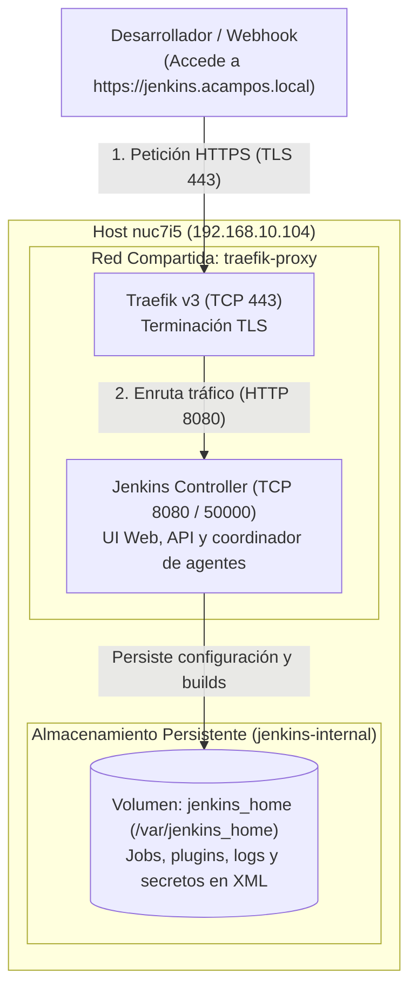

## 1. High Level Architecture

**Jenkins LTS** actúa como nuestro motor de automatización e integración continua (`CI/CD`). No requiere una base de datos relacional externa: toda la configuración del sistema, definiciones de _pipelines_, historial de ejecuciones (`builds`), credenciales cifradas y _plugins_ reside en ficheros XML dentro del volumen persistente `jenkins_home` (`/var/jenkins_home`).

[[03-traefik|Traefik v3]] realiza la terminación TLS en `https://jenkins.acampos.local` y reenvía el tráfico HTTP hacia el puerto `8080` del contenedor a través de la red `traefik-proxy`. Además, montamos el certificado raíz `/opt/traefik/root_ca.crt` para que los _pipelines_ y herramientas Java de Jenkins confíen en las conexiones HTTPS hacia [[06-gitlab|GitLab]], [[07-nexus|Nexus]] y [[08-quay|Quay]].



## 2. Requerimientos previos

- [[01-coredns|01. CoreDNS]], [[02-step-ca|02. Smallstep step-ca]] y [[03-traefik|03. Traefik v3]] operativos.
- Certificado raíz público de la PKI disponible en `/opt/traefik/root_ca.crt`.

## 3. Configuraciones

Crea el directorio `/opt/jenkins`:

```bash
sudo mkdir -p /opt/jenkins
```

```bash
sudo chown -R $USER:$USER /opt/jenkins
```

### 3.1. Archivo Compose (`/opt/jenkins/compose.yml`)

```yaml
services:
  jenkins:
    image: jenkins/jenkins:lts-jdk21
    container_name: jenkins
    environment:
      - JAVA_OPTS=-Djenkins.install.runSetupWizard=true -Xmx2048m
    labels:
      - traefik.enable=true
      - traefik.docker.network=traefik-proxy
      - traefik.http.routers.jenkins.rule=Host(`jenkins.acampos.local`)
      - traefik.http.routers.jenkins.entrypoints=websecure
      - traefik.http.routers.jenkins.tls=true
      - traefik.http.routers.jenkins.tls.certresolver=stepca
      - traefik.http.services.jenkins.loadbalancer.server.port=8080
    networks:
      - jenkins-internal
      - traefik-proxy
    ports:
      # Puerto JNLP opcional para conectar agentes de build externos
      - "50000:50000"
    restart: unless-stopped
    security_opt:
      - no-new-privileges:true
    volumes:
      - jenkins_home:/var/jenkins_home
      - /opt/traefik/root_ca.crt:/usr/local/share/ca-certificates/acampos-root-ca.crt:ro

networks:
  jenkins-internal:
  traefik-proxy:
    external: true

volumes:
  jenkins_home:
```

## 4. Despliegue y Configuración Inicial

1. Levanta el servicio:

```bash
cd /opt/jenkins
```

```bash
docker compose up -d
```

2. Obtén la contraseña inicial de administración generada durante el primer arranque:

```bash
docker exec jenkins cat /var/jenkins_home/secrets/initialAdminPassword
```

3. (Opcional, pero recomendado) Importa el certificado raíz de `step-ca` en el `cacerts` de la JVM de Jenkins para que los _plugins_ de GitLab y Maven confíen en `https://*.acampos.local`:

```bash
docker exec -u root jenkins keytool -importcert -noprompt \
  -trustcacerts -alias acampos-root-ca \
  -file /usr/local/share/ca-certificates/acampos-root-ca.crt \
  -keystore /opt/java/openjdk/lib/security/cacerts \
  -storepass changeit
```

4. Accede a `https://jenkins.acampos.local`, introduce la contraseña inicial e instala los plugins sugeridos. En la pantalla **Instance Configuration**, confirma que la **Jenkins URL** sea `https://jenkins.acampos.local/`.