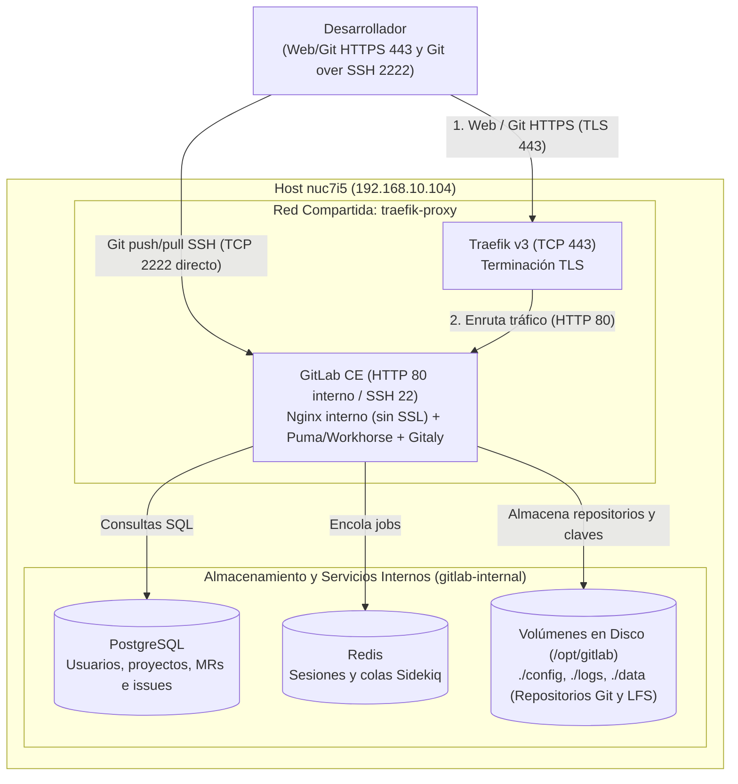

## 1. High Level Architecture

**GitLab CE** (*Community Edition*) centraliza la gestión de repositorios Git, revisiones de código (*Merge Requests*), gestión de incidencias y pipelines de CI/CD. La distribución oficial Omnibus coordina internamente la aplicación Rails (Puma/Workhorse), Gitaly (almacenamiento Git), PostgreSQL (metadatos relacionales) y Redis (colas de trabajos _Sidekiq_ y caché), persistiendo todo el estado en tres volúmenes dedicados (`config`, `logs` y `data`).

Dado que [[01-traefik|Traefik v3]] se encarga de la terminación TLS en `https://gitlab.acampos.local` (`TCP 443`) con certificados de [[00-step-ca|Smallstep step-ca]], configuramos el Nginx interno de GitLab para escuchar en HTTP plano (`TCP 80`) dentro de la red `traefik-proxy` (`nginx['listen_https'] = false`), mientras exponemos el acceso **Git over SSH** directamente en el puerto `2222` del host (para no colisionar con el puerto `22` del daemon OpenSSH del servidor anfitrión).



## 2. Requerimientos previos

- [[00-coredns|00. CoreDNS]], [[00-step-ca|00. Smallstep step-ca]] y [[01-traefik|01. Traefik v3]] operativos.
- Al menos **4 GB de RAM libres** en el host (GitLab Omnibus es intensivo en memoria).

## 3. Configuraciones

Crea la estructura de directorios en `/opt/gitlab` para configuración, registros y datos persistentes, además de copiar el certificado raíz de nuestra CA en `trusted-certs`:

```bash
sudo mkdir -p /opt/gitlab/{config/trusted-certs,logs,data}
```

```bash
sudo chown -R $USER:$USER /opt/gitlab
```

```bash
cp /opt/traefik/root_ca.crt /opt/gitlab/config/trusted-certs/acampos-root-ca.crt
```

### 3.1. Archivo Compose (`/opt/gitlab/compose.yml`)

En `GITLAB_OMNIBUS_CONFIG` indicamos a GitLab que su URL externa pública es `https://gitlab.acampos.local`, pero que su servidor web interno debe aceptar conexiones HTTP en el puerto `80` procedentes del proxy inverso Traefik:

```yaml
services:
  gitlab:
    image: gitlab/gitlab-ce:latest
    container_name: gitlab
    hostname: gitlab.acampos.local
    shm_size: "256m"
    environment:
      GITLAB_OMNIBUS_CONFIG: |
        external_url 'https://gitlab.acampos.local'
        nginx['listen_port'] = 80
        nginx['listen_https'] = false
        nginx['proxy_set_headers'] = {
          "X-Forwarded-Proto" => "https",
          "X-Forwarded-Ssl" => "on"
        }
        gitlab_rails['gitlab_shell_ssh_port'] = 2222
        puma['worker_processes'] = 2
        sidekiq['concurrency'] = 10
        prometheus_monitoring['enable'] = false
    labels:
      - traefik.enable=true
      - traefik.docker.network=traefik-proxy
      - traefik.http.routers.gitlab.rule=Host(`gitlab.acampos.local`)
      - traefik.http.routers.gitlab.entrypoints=websecure
      - traefik.http.routers.gitlab.tls=true
      - traefik.http.routers.gitlab.tls.certresolver=stepca
      - traefik.http.services.gitlab.loadbalancer.server.port=80
    networks:
      - gitlab-internal
      - traefik-proxy
    ports:
      # Acceso Git por SSH en el puerto 2222 del host
      - "2222:22"
    restart: unless-stopped
    volumes:
      - ./config:/etc/gitlab
      - ./logs:/var/log/gitlab
      - ./data:/var/opt/gitlab

networks:
  gitlab-internal:
  traefik-proxy:
    external: true
```

## 4. Despliegue y Verificación

1. Levanta el contenedor de GitLab (el primer arranque tarda entre 2 y 4 minutos mientras ejecuta `gitlab-ctl reconfigure`):

```bash
cd /opt/gitlab
```

```bash
docker compose up -d
```

2. Sigue el progreso de inicialización y comprueba el estado de salud de los subservicios internos:

```bash
docker exec gitlab gitlab-ctl status
```

3. Recupera la contraseña temporal del usuario administrador (`root`), que se almacena durante las primeras 24 horas en `/etc/gitlab/initial_root_password`:

```bash
docker exec gitlab grep "Password:" /etc/gitlab/initial_root_password
```

4. Accede a `https://gitlab.acampos.local`, inicia sesión con el usuario `root` y cambia inmediatamente la contraseña desde *User Settings -> Password*.
5. Para clonar repositorios vía SSH utilizando el puerto `2222`, la URL mostrada en la interfaz de GitLab será automáticamente:
   `ssh://git@gitlab.acampos.local:2222/<grupo>/<proyecto>.git`