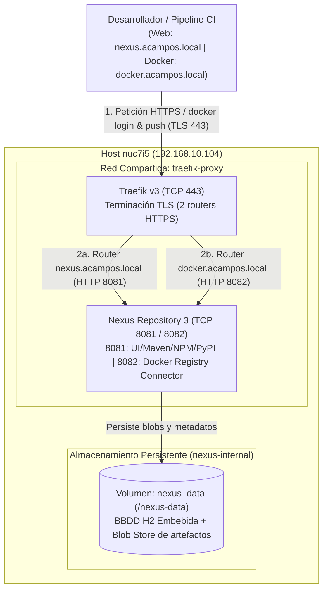

## 1. High Level Architecture

**Sonatype Nexus Repository Manager 3** actúa como nuestro repositorio privado y proxy caché de artefactos (Maven, npm, PyPI, NuGet, APT) y registro secundario de contenedores Docker. Utiliza una base de datos embebida (**H2**) para los metadatos e índices de búsqueda y un **Blob Store** en disco dentro del volumen `nexus_data` (`/nexus-data`) para almacenar los paquetes binarios.

Para evitar que los clientes de Docker tengan que especificar puertos en los comandos `docker pull/push`, configuramos **dos routers independientes en [[01-traefik|Traefik v3]]** apuntando al mismo contenedor:

1. `https://nexus.acampos.local` -> redirige al puerto `8081` (Interfaz web, API REST y repositorios Maven/npm/PyPI).
2. `https://docker.acampos.local` -> redirige al puerto `8082` (Conector HTTP dedicado al _Docker Registry_ dentro de Nexus).



## 2. Requerimientos previos

- [[01-coredns|01. CoreDNS]] resolviendo `*.acampos.local` (`nexus.acampos.local` y `docker.acampos.local`) hacia `192.168.10.104`.
- [[02-step-ca|02. Smallstep step-ca]] y [[03-traefik|03. Traefik v3]] operativos.

## 3. Configuraciones

Crea el directorio `/opt/nexus`:

```bash
sudo mkdir -p /opt/nexus
```

```bash
sudo chown -R $USER:$USER /opt/nexus
```

### 3.1. Archivo Compose (`/opt/nexus/compose.yml`)

```yaml
services:
  nexus:
    image: sonatype/nexus3:latest
    container_name: nexus
    environment:
      - INSTALL4J_ADD_VM_PARAMS=-Xms1024m -Xmx2048m -XX:MaxDirectMemorySize=2048m
    labels:
      - traefik.enable=true
      - traefik.docker.network=traefik-proxy
      # Router 1: Interfaz Web y Repositorios de Paquetes (Puerto 8081)
      - traefik.http.routers.nexus-ui.rule=Host(`nexus.acampos.local`)
      - traefik.http.routers.nexus-ui.entrypoints=websecure
      - traefik.http.routers.nexus-ui.tls=true
      - traefik.http.routers.nexus-ui.tls.certresolver=stepca
      - traefik.http.routers.nexus-ui.service=nexus-ui-svc
      - traefik.http.services.nexus-ui-svc.loadbalancer.server.port=8081
      # Router 2: Conector dedicado para Docker Registry (Puerto 8082)
      - traefik.http.routers.nexus-docker.rule=Host(`docker.acampos.local`)
      - traefik.http.routers.nexus-docker.entrypoints=websecure
      - traefik.http.routers.nexus-docker.tls=true
      - traefik.http.routers.nexus-docker.tls.certresolver=stepca
      - traefik.http.routers.nexus-docker.service=nexus-docker-svc
      - traefik.http.services.nexus-docker-svc.loadbalancer.server.port=8082
    networks:
      - nexus-internal
      - traefik-proxy
    restart: unless-stopped
    security_opt:
      - no-new-privileges:true
    volumes:
      - nexus_data:/nexus-data

networks:
  nexus-internal:
  traefik-proxy:
    external: true

volumes:
  nexus_data:
```

## 4. Despliegue y Configuración Inicial

1. Levanta el contenedor de Nexus:

```bash
cd /opt/nexus
```

```bash
docker compose up -d
```

2. Espera alrededor de 60 segundos a que el servidor Jetty interno termine de arrancar y obtén la contraseña inicial del usuario `admin`:

```bash
docker exec nexus cat /nexus-data/admin.password && echo ""
```

3. Accede a `https://nexus.acampos.local`, inicia sesión con `admin` y sigue el asistente para establecer tu contraseña definitiva.

4. **Para habilitar el registro Docker en `https://docker.acampos.local`**:

   - Ve a *Server Administration and Configuration (icono de engranaje) -> Repository -> Repositories -> Create repository -> docker (hosted)*.
   - Asígnale un nombre (por ejemplo, `docker-internal`), marca la casilla **HTTP connector** y escribe el puerto **`8082`**.
   - En *Security -> Realms*, añade **Docker Bearer Token Realm** a la columna de activos.
   - Prueba la autenticación desde terminal:
   
```bash
docker login docker.acampos.local
```