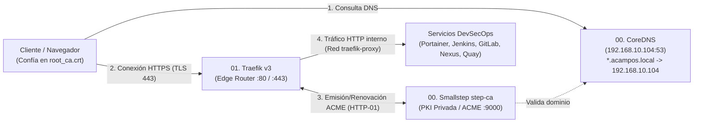

Este directorio documenta el diseño, configuración y despliegue paso a paso de los servicios que componen el laboratorio local sobre el nodo anfitrión `nuc7i5` (`192.168.10.104`) bajo el dominio interno `*.acampos.local`.

## 1. Arquitectura Global y Flujo de Peticiones

Todos los servicios se articulan sobre tres pilares fundamentales de infraestructura antes de levantar cualquier aplicación de usuario:

1. **Resolución de nombres ([[01-coredns|CoreDNS]]):** El cliente consulta cualquier subdominio `*.acampos.local` a CoreDNS (`192.168.10.104:53`), que responde de forma autoritativa con la IP del nodo `192.168.10.104` (y reenvía a `1.1.1.1`/`8.8.8.8` las consultas a Internet).

2. **Certificados TLS automáticos ([[02-step-ca|Smallstep step-ca]]):** Actúa como nuestra Autoridad Certificadora privada con soporte ACME.

3. **Enrutamiento y terminación TLS ([[03-traefik|Traefik v3]]):** Escucha los eventos del socket de Docker, solicita un certificado a `step-ca` para cada nuevo contenedor con `traefik.enable=true` y enruta el tráfico por la red privada compartida `traefik-proxy`.

## 2. Servicios de Infraestructura Base

> [!important] Orden de despliegue obligatorio
> Respeta siempre el orden numérico de esta tabla al inicializar el nodo anfitrión desde cero.

| Orden | Servicio | Dominio / Endpoint | Propósito |
| :---: | :--- | :--- | :--- |
| **00** | [[00-coredns-host-prepare\|Preparación del Host]] | `192.168.10.104` | Liberación del puerto `53` (`systemd-resolved`) y creación de la red `traefik-proxy`. |
| **01** | [[01-coredns\|CoreDNS]] | `ns1.acampos.local` (`:53`) | Servidor DNS autoritativo local (`*.acampos.local` + zona inversa `PTR`) y _forwarder_. |
| **02** | [[02-step-ca\|Smallstep step-ca]] | `ca.acampos.local` (`:9000`) | Autoridad Certificadora (PKI) privada y servidor ACME local para emisión automática de TLS. |
| **03** | [[03-traefik\|Traefik v3]] | `https://traefik.acampos.local` | Proxy inverso, _Edge Router_ dinámico y punto de terminación del túnel TLS (`:80` / `:443`). |
| **04** | [[04-portainer\|Portainer CE]] | `https://portainer.acampos.local` | Interfaz web y API para la gestión centralizada de contenedores, volúmenes y redes Docker. |

## 3. Servicios de Plataforma DevSecOps

Cada servicio de plataforma dispone de su propia red interna aislada (`<servicio>-internal`) para comunicar su aplicación con sus bases de datos (`PostgreSQL`, `Redis`), conectando únicamente el contenedor frontal a la red compartida `traefik-proxy`:

| Orden | Servicio | Dominio / Endpoint | Propósito |
| :---: | :--- | :--- | :--- |
| **05** | [[05-jenkins\|Jenkins LTS]] | `https://jenkins.acampos.local` | Servidor de automatización e integración/entrega continua (`CI/CD`). |
| **06** | [[06-gitlab\|GitLab CE]] | `https://gitlab.acampos.local` `ssh://...:2222` | Plataforma integral de desarrollo, control de versiones Git, _Merge Requests_ y CI. |
| **07** | [[07-nexus\|Sonatype Nexus 3]] | `https://nexus.acampos.local` `https://docker.acampos.local` | Repositorio privado de artefactos, proxy caché local (Maven, npm, PyPI) y _Docker Registry_. |
| **08** | [[08-quay\|Project Quay]] | `https://quay.acampos.local` | Registro empresarial de imágenes de contenedor y artefactos OCI respaldado por PostgreSQL y Redis. |
| **09** | SonarQube *(Próximamente)* | `https://sonarqube.acampos.local` | Plataforma de análisis estático de código y calidad (`SAST`). |
| **10** | OWASP Dependency-Track *(Próximamente)* | `https://dtrack.acampos.local` | Plataforma de análisis de composición de software (`SCA`) y gestión de `SBOM`. |
