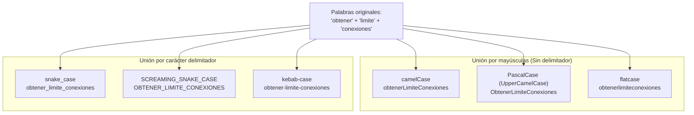
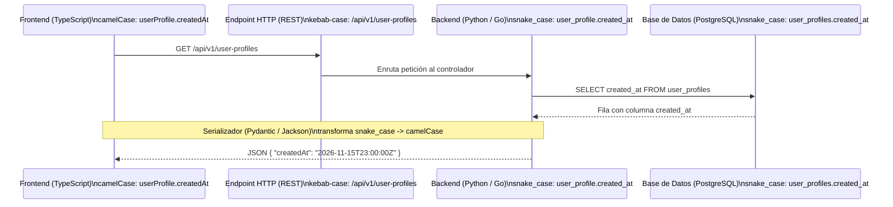

---
aliases:
  - Naming Conventions
  - Convenciones de nombres
  - Notaciones de nombres
  - Case styles
date: 2026-11-15
description: Guía comparativa sobre las principales convenciones de nombres en ingeniería del software e infraestructura (camelCase, snake_case, PascalCase, kebab-case y variantes como SCREAMING_SNAKE_CASE y flatcase), por qué existen y qué estándar usar según el lenguaje o tecnología.
draft: false
enableToc: true
publish: true
tags:
  - software_engineering
  - clean_code
  - naming_conventions
  - devops
  - programming
title: "Convenciones de nombres (Naming Conventions): camelCase, snake_case, PascalCase y kebab-case"
---

En programación y administración de sistemas no podemos usar espacios en blanco dentro de los nombres de variables, funciones, clases, rutas de archivos o recursos de infraestructura. Si escribimos `calcular precio total = 100`, el compilador o el intérprete de comandos (`shell`) interpretará tres identificadores distintos separados por espacios y lanzará un error de sintaxis.

Para unir múltiples palabras en un único identificador sin perder legibilidad humana ni romper las reglas léxicas de los lenguajes, la industria del software ha estandarizado distintas **convenciones de capitalización y separación de palabras** (*Naming Conventions* o *Case Styles*): **[[camel-case|camelCase]]**, **[[snake-case|snake_case]]**, **[[pascal-case|PascalCase]]** y **[[kebab-case|kebab-case]]** (además de variantes especializadas como `SCREAMING_SNAKE_CASE` o `flatcase`).

> [!NOTE] ¿Por qué importa elegir la convención correcta?
> En algunos lenguajes es una cuestión de **estilo y consistencia** (por ejemplo, `PEP 8` en Python), pero en otros tiene **efectos semánticos directos en el compilador**: en **Go**, que una función empiece por mayúscula ([[pascal-case|PascalCase]]) o minúscula ([[camel-case|camelCase]]) determina si es pública o privada; y en **React (`JSX`)**, determina si una etiqueta se interpreta como un componente personalizado o como un elemento HTML nativo.

---

## Mapa visual de las convenciones de nombres

Imagina que necesitamos representar el concepto **«usuario administrador activo»** o **«obtener límite de conexiones»** en código. Así se transforma según cada convención:

---

## Tabla comparativa general

| Convención | Ejemplo visual | Regla de formación | Dónde es el estándar principal |
| :--- | :--- | :--- | :--- |
| **[[camel-case\|camelCase]]** (*lowerCamelCase*) | `maxRetryCount` `getUserById` | Primera palabra en minúscula; cada palabra siguiente empieza con mayúscula, sin espacios ni guiones. | Variables, propiedades y funciones en **JavaScript**, **TypeScript**, **Java**, **Kotlin** y claves en **JSON**. Variables privadas en **Go**. |
| **[[pascal-case\|PascalCase]]** (*UpperCamelCase*) | `MaxRetryCount` `UserRepository` | **Todas** las palabras (incluida la primera) empiezan con letra mayúscula, sin separadores. | Nombres de **clases**, **interfaces**, `types` y `enums` en casi todos los lenguajes (`Python`, `TS`, `Java`, `C#`, `Rust`). Componentes en **React** y símbolos exportados en **Go**. |
| **[[snake-case\|snake_case]]** (*pothole_case*) | `max_retry_count` `get_user_by_id` | Todas las letras en minúscula; las palabras se separan mediante **guion bajo** (`_`). | Variables, funciones y módulos en **Python** (`PEP 8`), **Rust**, **Ruby** y **C**. Nombres de tablas y columnas en **bases de datos SQL** (`PostgreSQL`, `MySQL`) y recursos en **Terraform**. |
| **`SCREAMING_SNAKE_CASE`** (*CONSTANT_CASE*) | `MAX_RETRY_COUNT` `DATABASE_URL` | Todas las letras en **mayúscula** separadas por **guion bajo** (`_`). (Variante de [[snake-case\|snake_case]]). | **Variables de entorno** en Linux/contenedores, **constantes globales** en Python/JS/Java/C/Rust y capacidades del kernel de Linux (p. ej., [[CAP_NET_ADMIN]]). |
| **[[kebab-case\|kebab-case]]** (*dash-case* / *lisp-case*) | `max-retry-count` `user-profile` | Todas las letras en minúscula separadas por **guion medio** (`-`). | **URLs y rutas REST**, clases y propiedades **CSS** (`background-color`), banderas de CLI (`--dry-run`), nombres de paquetes (`npm`, `cargo`), repositorios Git y objetos en **Kubernetes**. |
| **`flatcase`** | `maxretrycount` `djangoproject` | Todas las letras en minúscula continuas, sin separadores ni mayúsculas. | Nombres de **paquetes cortos en Go y Java** (`package nethttp`), nombres de usuario de Linux y algunos comandos de terminal (`systemctl`, `journalctl`). |

---

## ¿Qué convención usar según el lenguaje o tecnología?

Cuando trabajas en proyectos modernos (*Full-Stack*, `DevOps` o `Platform Engineering`), es habitual cruzar varios lenguajes en un mismo repositorio. Esta matriz resume la convención idiomática de cada ecosistema:

| Lenguaje / Tecnología | Variables y Funciones | Clases / Tipos / Structs | Constantes Globales | Archivos / Módulos / Paquetes |
| :--- | :--- | :--- | :--- | :--- |
| **Python** (`PEP 8`) | [[snake-case\|snake_case]] | [[pascal-case\|PascalCase]] | `SCREAMING_SNAKE_CASE` | [[snake-case\|snake_case]] (`auth_service.py`) |
| **TypeScript / JavaScript** | [[camel-case\|camelCase]] | [[pascal-case\|PascalCase]] | `SCREAMING_SNAKE_CASE` o [[camel-case\|camelCase]] | [[kebab-case\|kebab-case]] (`user-auth.ts`) o [[pascal-case\|PascalCase]] (`UserCard.tsx`) |
| **Go (Golang)** | [[camel-case\|camelCase]] (privado) [[pascal-case\|PascalCase]] (público) | [[pascal-case\|PascalCase]] (público) [[camel-case\|camelCase]] (privado) | [[pascal-case\|PascalCase]] o [[camel-case\|camelCase]] | [[snake-case\|snake_case]] en archivos (`user_test.go`) y `flatcase` en paquetes (`httputil`) |
| **Rust** | [[snake-case\|snake_case]] | [[pascal-case\|PascalCase]] | `SCREAMING_SNAKE_CASE` | [[snake-case\|snake_case]] (módulos) / [[kebab-case\|kebab-case]] (crates en `Cargo.toml`) |
| **Java / Kotlin** | [[camel-case\|camelCase]] | [[pascal-case\|PascalCase]] | `SCREAMING_SNAKE_CASE` | [[pascal-case\|PascalCase]] (`UserService.java`) / paquetes en `flatcase` |
| **C# (.NET)** | [[camel-case\|camelCase]] (locales) [[pascal-case\|PascalCase]] (métodos y propiedades) | [[pascal-case\|PascalCase]] | [[pascal-case\|PascalCase]] | [[pascal-case\|PascalCase]] (`OrderController.cs`) |
| **SQL (`PostgreSQL`)** | [[snake-case\|snake_case]] (tablas y columnas) | N/A | N/A | [[snake-case\|snake_case]] (`001_create_users.sql`) |
| **Infraestructura (`K8s`, `Terraform`, `Docker`)** | [[snake-case\|snake_case]] (recursos e identificadores en Terraform) | N/A | `SCREAMING_SNAKE_CASE` (`ENV` en Docker/K8s) | [[kebab-case\|kebab-case]] (nombres de Pods, Deployments, Namespaces en K8s) |

---

## El problema del cruce de fronteras (Serialización API <-> Base de Datos)

Uno de los puntos donde más errores cometen los ingenieros junior ocurre cuando los datos viajan a través de distintas capas de una arquitectura:

1. **En la base de datos (`PostgreSQL`):** La columna se llama `created_at` ([[snake-case|snake_case]]).
2. **En el backend (`Python` / `FastAPI`):** El atributo del modelo se llama `created_at` ([[snake-case|snake_case]]).
3. **En el payload `JSON` y el frontend (`TypeScript` / `React`):** El estándar es recibir `createdAt` ([[camel-case|camelCase]]).
4. **En la URL del navegador o del endpoint REST:** El recurso se expone como `/api/v1/user-profiles` ([[kebab-case|kebab-case]]).

> [!TIP] No mezcles convenciones manualmente: delega en el serializador
> Nunca escribas variables en `camelCase` dentro de tu código Python solo para que coincidan con el frontend, ni uses `snake_case` en tu estado de React para que coincida con la base de datos. Configura un **alias generator** en tu librería de serialización (por ejemplo, `alias_generator=to_camel` en **Pydantic** para Python, o las etiquetas `` `json:"createdAt"` `` en **Go**) para que cada lenguaje mantenga su estilo nativo sin fricción.

---

## Reglas para tratar siglas y acrónimos (`HTTP`, `XML`, `ID`, `URL`)

Una duda muy frecuente al aplicar [[camel-case|camelCase]] o [[pascal-case|PascalCase]] es cómo capitalizar siglas como `HTTP`, `JSON`, `URL` o `ID`:

* **En [[camel-case|camelCase]] y [[pascal-case|PascalCase]]:** La práctica moderna recomendada por las guías de estilo de Google, Microsoft (.NET) y TypeScript es **tratar los acrónimos de más de dos letras como palabras normales** (solo la primera letra en mayúscula) para que sea obvio dónde empieza la siguiente palabra:
  * ✅ Preferible: `parseXmlDocument`, `HttpClient`, `loadJsonConfig`, `userId`.
  * ❌ Difícil de leer: `parseXMLDocument`, `HTTPClient`, `USERID` (en `XMLHTTPRequest` no se distingue visualmente dónde termina `XML` y empieza `HTTP`).
* **En [[snake-case|snake_case]] y [[kebab-case|kebab-case]]:** Este problema no existe porque el separador (`_` o `-`) delimita claramente cada término: `parse_xml_document`, `http-client`, `user_id`.

---

## Fichas detalladas por convención

Profundiza en las reglas léxicas, casos de uso, historia y ejemplos de código de cada convención en sus notas dedicadas:

* **[[camel-case|camelCase (lowerCamelCase)]]:** El estándar en JavaScript/TypeScript, Java, JSON y visibilidad interna en Go.
* **[[snake-case|snake_case y SCREAMING_SNAKE_CASE]]:** El rey de la legibilidad en Python, Rust, bases de datos SQL, Terraform y variables de entorno en Linux.
* **[[pascal-case|PascalCase (UpperCamelCase)]]:** La convención universal para tipos, clases, interfaces, componentes UI y exportación en Go.
* **[[kebab-case|kebab-case (dash-case)]]:** Por qué no puede usarse en variables de casi ningún lenguaje (se interpreta como resta `-`), pero domina en URLs, CSS, CLI, Git y Kubernetes.

---

## Referencias

1. van Rossum, G., Warsaw, B., & Coghlan, N. (2001). *PEP 8 – Style Guide for Python Code*. [https://peps.python.org/pep-0008/](https://peps.python.org/pep-0008/)
2. Google Style Guides (*TypeScript, Java, Python, Go, C++*). [https://google.github.io/styleguide/](https://google.github.io/styleguide/)
3. Rust API Guidelines — *Naming (`C-CASE`)*. [https://rust-lang.github.io/api-guidelines/naming.html](https://rust-lang.github.io/api-guidelines/naming.html)
4. Microsoft .NET Framework Design Guidelines — *Capitalization Conventions*. [https://learn.microsoft.com/en-us/dotnet/standard/design-guidelines/capitalization-conventions](https://learn.microsoft.com/en-us/dotnet/standard/design-guidelines/capitalization-conventions)
