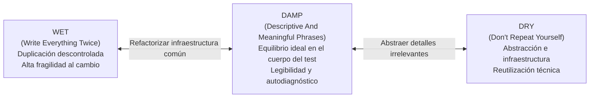
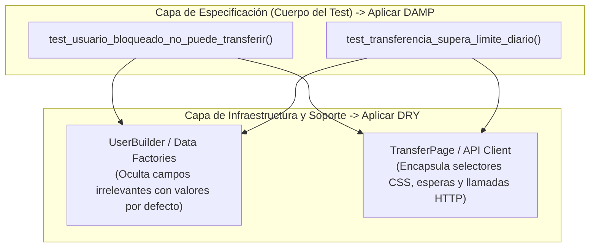

---
aliases:
  - DRY vs DAMP vs WET
  - Principios de diseño en testing
  - Testing DRY DAMP WET
date: 2026-11-15
description: Guía comparativa sobre los principios DRY, WET y DAMP aplicados a la automatización de pruebas (Testing Automation), cómo equilibrar mantenibilidad y legibilidad, y qué abstraer o repetir en tus suites de tests.
draft: false
enableToc: true
publish: true
tags:
  - software_engineering
  - testing
  - test_automation
  - clean_code
  - architecture
title: "DRY, WET y DAMP en Testing Automation"
---

En el desarrollo de software de producción, nos enseñan desde el primer día una regla casi sagrada: **no repitas código** ([[DRY]] — *Don't Repeat Yourself*). Si copias y pegas lógica de negocio en varios sitios, cualquier cambio futuro requerirá actualizar múltiples archivos, multiplicando el riesgo de introducir errores.

Sin embargo, cuando trasladamos esa misma mentalidad de forma estricta al código de **automatización de pruebas** (*Testing Automation*), suele ocurrir el efecto contrario al deseado: terminamos con suites de pruebas llenas de bucles, condicionales, herencias complejas y funciones auxiliares (*helpers*) tan abstractas que, cuando un test falla en el pipeline de integración continua (`CI/CD`), nadie entiende qué estaba probando realmente sin pasar media hora depurando.

Aquí es donde entran en juego tres conceptos fundamentales que definen el espectro entre la **abstracción** y la **legibilidad** en las pruebas automatizadas: **[[DRY]]**, **[[WET]]** y **[[DAMP]]**.

> [!NOTE] La diferencia fundamental entre código de producción y código de tests
> El código de producción tiene su propia suite de pruebas que verifica que funciona correctamente. **¿Quién prueba a los tests?** Nadie. La única defensa contra errores en los propios tests es mantenerlos tan **simples, lineales y explícitos** que su corrección sea evidente a simple vista.

---

## El espectro: de la repetición pura a la abstracción extrema

Podemos imaginar estos tres principios como puntos dentro de una balanza donde un extremo prioriza no repetir ni una sola línea de código y el otro extremo prioriza no tener ninguna capa de indirección:

* **[[WET]] (*Write Everything Twice* / *We Enjoy Typing*):** Representa la duplicación pura por copia y pega (*copy-paste*). Cada test reimplementa desde cero cómo conectarse a la base de datos, cómo construir payloads JSON de 50 líneas o cómo localizar botones mediante selectores CSS crudos. Cuando cambia un selector o un campo obligatorio en la API, se rompen 80 tests de golpe.
* **[[DRY]] (*Don't Repeat Yourself*):** Busca que cada pieza de conocimiento tenga una única representación. En automatización de pruebas es **imprescindible en la capa de infraestructura** (*Page Objects*, clientes HTTP, factorías de datos, *fixtures*), pero **peligroso si se aplica en exceso dentro del cuerpo del test**, ya que oculta la relación entre la entrada (*Arrange*) y el resultado esperado (*Assert*).
* **[[DAMP]] (*Descriptive And Meaningful Phrases*):** Es el punto de equilibrio recomendado por la industria (popularizado entre otros por Jay Fields y el libro *Software Engineering at Google*). Defiende que **en los tests la legibilidad es más importante que evitar cierta duplicación**. Un buen test [[DAMP]] puede permitirse repetir parte de la preparación de datos si eso hace que cualquiera pueda leer el test de arriba abajo como un documento autónomo y entender inmediatamente por qué ha fallado.

---

## Tabla comparativa rápida

| Dimensión | [[DRY]] (*Don't Repeat Yourself*) | [[WET]] (*Write Everything Twice*) | [[DAMP]] (*Descriptive And Meaningful Phrases*) |
| :--- | :--- | :--- | :--- |
| **Objetivo principal** | Eliminar duplicación y centralizar el mantenimiento. | Salir del paso rápido copiando y pegando un test existente. | Maximizar la claridad, expresividad y velocidad de diagnóstico del test. |
| **Coste de cambio (Mantenimiento)** | **Bajo:** un cambio en la aplicación se actualiza en un único *helper* o *Page Object*. | **Muy alto:** un cambio mínimo obliga a editar decenas de archivos de test. | **Moderado / Bajo:** la infraestructura está centralizada ([[DRY]]), aunque los valores del escenario se declaran explícitamente en cada test. |
| **Legibilidad del test individual** | **Baja si se abusa:** obliga a saltar entre 4 o 5 archivos o métodos `beforeEach` para saber qué datos existen. | **Baja por ruido visual:** 60 líneas de configuración repetitiva ocultan las 2 líneas que realmente importan. | **Alta:** el test muestra explícitamente los datos relevantes para su caso y oculta el ruido técnico tras nombres descriptivos. |
| **Riesgo de bugs en el propio test** | **Alto si hay lógica:** bucles, `if/else` y concatenaciones dinámicas dentro de los tests pueden ocultar falsos positivos. | **Alto por inconsistencias:** al copiar y pegar es común olvidar actualizar una aserción o dejar datos obsoletos. | **Muy bajo:** flujo lineal `Arrange -> Act -> Assert` con valores literales claros. |
| **Dónde aplicarlo en Testing** | En la **capa de soporte**: *Page Object Model* (`POM`), *Builders*, *Fixtures* de conexión y clientes de API. | **Temporalmente** al explorar o prototipar los primeros 2 tests antes de aplicar la *Regla de Tres* (*Rule of Three*). | En el **cuerpo de cada test** (`test(...)` / `def test_...()`), en los nombres de los tests y en los mensajes de aserción. |

---

## La regla de oro: DAMP en el test, DRY en la infraestructura

El error más común de los ingenieros júnior al aprender sobre [[DRY]] y [[DAMP]] es pensar que son enemigos irreconciliables. En realidad, **son complementarios** y operan en capas distintas de la arquitectura de automatización:

1. **En el cuerpo del test manda [[DAMP]]:**
   Cuando abras un archivo de test, cada prueba debe contar una historia completa por sí sola (patrón **AAA**: *Arrange, Act, Assert*). Si el test comprueba que un menor de 18 años no puede registrarse, la edad `17` **debe aparecer literalmente escrita dentro de ese test**, no escondida en la línea 240 de un archivo `fixtures.json` compartido por toda la empresa.
2. **Por debajo del test manda [[DRY]]:**
   El *cómo* se crea ese usuario en la base de datos o el *cómo* se rellena el formulario web con Playwright debe estar encapsulado en constructores (*Builders* / *Object Mothers*) o *Page Objects* siguiendo el principio [[DRY]]. Así, si mañana el formulario de registro añade un campo obligatorio `acepta_terminos` o cambia un selector `#submit-btn`, solo tocas un archivo de infraestructura y ningún test se rompe.

---

## ¿Qué abstraer y qué repetir? Guía práctica de decisión

Cuando tengas dudas sobre si extraer código repetido en tu suite de pruebas o dejarlo duplicado, hazte estas preguntas:

### Cuándo aplicar [[DRY]] (Extraer y reutilizar)
* **Selectores de interfaz de usuario (`UI`) y rutas de `API`:** Nunca repitas `page.locator('[data-testid="checkout-submit"]')` ni URLs como `POST /api/v2/orders/checkout` en 30 tests. Usa el patrón *Page Object Model* o clientes de API.
* **Construcción de objetos complejos con muchos campos obligatorios:** Si la entidad `Pedido` requiere 15 propiedades para no dar error de validación en base de datos, usa una factoría o *Builder* (`create_order(status="CANCELLED")`) que rellene los otros 14 campos por defecto.
* **Autenticación y configuración técnica del entorno:** Levantar contenedores con *Testcontainers*, limpiar transacciones de base de datos o inyectar tokens `JWT` de sesión debe hacerse en *fixtures* reutilizables.

### Cuándo aplicar [[DAMP]] (Permitir repetición controlada y explícita)
* **Datos que son la causa directa del resultado del test:** Si tu aserción verifica `expect(total).toBe(90)` tras aplicar un cupón del 10%, tanto el precio original (`100`) como el descuento (`10%`) deben verse explícitamente en el bloque *Arrange* de ese mismo test.
* **Flujo de negocio de extremo a extremo (*Given / When / Then*):** Aunque tres tests distintos hagan login y naveguen al carrito antes de probar distintas formas de pago, es preferible que en cada test se lea explícitamente `await loginAs(user)` y `await cart.goToCheckout()` en lugar de ocultarlo todo en un `beforeEach` gigante que obliga al lector a hacer *scroll* hacia arriba para adivinar en qué pantalla empieza el test.
* **Valores esperados en las aserciones (*Assertions*):** Nunca calcules el valor esperado copiando y pegando la misma fórmula matemática o concatenación de strings que usa el código de producción. Escribe el valor literal esperado.

> [!TIP] Empieza por las fichas individuales
> Explora en detalle cada uno de los tres conceptos con ejemplos prácticos en **Python (`pytest`)** y **TypeScript (`Playwright` / `Jest`)**:
> - **[[DRY]] (*Don't Repeat Yourself*):** Cómo reutilizar infraestructura de pruebas sin caer en la sobreabstracción.
> - **[[WET]] (*Write Everything Twice*):** Cómo detectar la duplicación tóxica en suites E2E/API y cuándo la *Regla de Tres* justifica esperar antes de abstraer.
> - **[[DAMP]] (*Descriptive And Meaningful Phrases*):** Cómo diseñar tests autoexplicativos mediante *Test Data Builders*, helpers de dominio y el patrón *Arrange-Act-Assert*.

---

## Referencias

1. Winters, T., Manshreck, T., & Wright, H. (2020). *Software Engineering at Google: Lessons Learned from Programming Over Time* (Capítulo 12: *Unit Testing* — "Make Tests DAMP, Not DRY"). O'Reilly Media. [https://abseil.io/resources/swe-book/html/ch12.html](https://abseil.io/resources/swe-book/html/ch12.html)
2. Fields, J. (2014). *Working Effectively with Unit Tests*. Leanpub.
3. Hunt, A., & Thomas, D. (1999). *The Pragmatic Programmer: From Journeyman to Master*. Addison-Wesley.
4. Meszaros, G. (2007). *xUnit Test Patterns: Refactoring Test Code*. Addison-Wesley.
